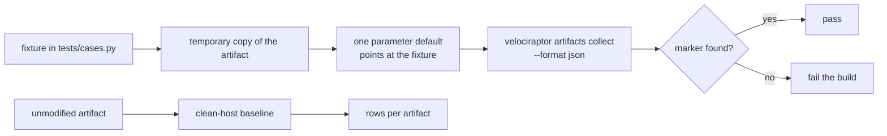

# velociraptor-triage-artifacts

[](https://github.com/youssefbouaouina/velociraptor-triage-artifacts/actions/workflows/ci.yml)
[](LICENSE)


A pack of 12 read-only [Velociraptor](https://docs.velociraptor.app/) artifacts (VQL) for fast
incident triage on Windows and Linux. Every artifact has a harmless positive test and a
clean-host baseline that runs on GitHub Actions on `windows-latest` and `ubuntu-latest`.

## Why

Velociraptor ships excellent artifacts, but an incident responder still spends the first hour
answering the same questions: what starts at logon, which service binary lives somewhere a user
can write, which timer survived the reboot, who added an SSH key. This pack turns those
questions into small, named, parameterised artifacts that return evidence instead of a verdict.

The second goal is trust. A detector you cannot test is a guess, so each artifact here:

1. has a fixture that plants a harmless marker;
2. runs through the real Velociraptor binary, not a mocked VQL interpreter;
3. must return the marker, or the build fails;
4. also runs unmodified on a clean runner so the row count is known before an incident.

The artifacts never delete, quarantine or "fix" anything. They read files and registry values.

## Artifacts

| Artifact | Platform | ATT&CK | What it shows |
|---|---|---|---|
| `Custom.Windows.Triage.Persistence` | Windows | T1547.001, T1547.004 | Run/RunOnce, Startup folders, Winlogon values |
| `Custom.Windows.Triage.LogonScripts` | Windows | T1037.001, T1547.004 | Userinit/Shell/AppInit_DLLs and `UserInitMprLogonScript` |
| `Custom.Windows.Triage.UserWritableServices` | Windows | T1543.003, T1574.009 | Service `ImagePath`/`ServiceDll` under user-writable paths |
| `Custom.Windows.Triage.ScheduledTasksEncoded` | Windows | T1053.005, T1027 | Task XML containing encoded or hidden PowerShell |
| `Custom.Windows.Triage.PrefetchLOLBins` | Windows | T1218, T1059 | Recent Prefetch entries for LOLBins |
| `Custom.Windows.Triage.PowerShellHistory` | Windows | T1059.001 | `ConsoleHost_history.txt` content per profile |
| `Custom.Windows.Triage.DefenderExclusions` | Windows | T1562.001 | Defender path, extension and process exclusions |
| `Custom.Linux.Triage.CronPersistence` | Linux | T1053.003 | System and per-user cron, plus `rc.local` |
| `Custom.Linux.Triage.SystemdTimers` | Linux | T1053.006 | Timer units and the service they trigger |
| `Custom.Linux.Triage.SSHAuthorizedKeys` | Linux | T1098.004 | Every `authorized_keys`, with content and mtime |
| `Custom.Linux.Triage.SuidBinaries` | Linux | T1548.001 | SUID files outside the standard system paths |
| `Custom.Linux.Triage.SudoersChanges` | Linux | T1548.003 | `sudoers` and every drop-in under `sudoers.d` |

All artifacts are in [`artifacts/windows`](artifacts/windows) and
[`artifacts/linux`](artifacts/linux). Parameters use comma-separated globs so a responder can
point them at a mounted image or a single directory without editing VQL.

## How it works



The test only edits a temporary copy. The shipped YAML keeps its real default globs, so what
CI tests is the same file a responder imports.

## Results

Measured with Velociraptor **0.77.3** (the version pinned in `tests/fetch_velociraptor.py`).
`python tests/run_tests.py` writes a JSON report with one row per artifact.

### Local Windows 11 host (author's machine)

Run 2026-11-05, [`results/local-windows.json`](results/local-windows.json):

| Artifact | Positive test | Baseline rows on this host |
|---|---|---|
| `Persistence` | pass | 14 |
| `LogonScripts` | pass | 3 |
| `UserWritableServices` | pass | 4 |
| `ScheduledTasksEncoded` | pass | 0 |
| `PrefetchLOLBins` | pass | 6 |
| `PowerShellHistory` | pass | 1 |
| `DefenderExclusions` | pass | 0 |

**7/7 passed.** The zero-row baselines are honest: this host has no matching scheduled task and
no Defender exclusion configured, so a zero is the expected answer, not a broken query.

### CI (Windows and Linux)

The `test` matrix runs both operating systems on a fresh runner; the reports are uploaded as
workflow artifacts (`triage-report-windows`, `triage-report-linux`). The exact counts from the
latest run are recorded in [`results/`](results/) after each run so the README never quotes a
number that cannot be reproduced.

## Run

```bash
python tests/fetch_velociraptor.py --dest bin
python tests/run_tests.py --binary bin/velociraptor --platform linux
# Windows:
python tests/run_tests.py --binary bin\velociraptor.exe --platform windows
```

The runner exits non-zero if any artifact errors, returns unparsable output, or loses its marker.
`--keep-fixtures` leaves the planted test files behind for inspection; by default they are
removed in a `finally` block even when the test fails.

### Import the pack into a Velociraptor server

1. Copy `artifacts/windows/*.yaml` to the server's artifact directory, or use
   `velociraptor config repack` with an `artifact_definitions` directory.
2. Restart the server or run `velociraptor --config server.config.yaml config repack`.
3. On the client, collect with
   `velociraptor.exe artifacts collect Custom.Windows.Triage.Persistence --format json`.
4. Parameters are visible in the GUI under the artifact's `Parameters` tab; every default is a
   safe read-only glob.

## Limitations

- A positive test proves that the query returns the planted evidence. It does **not** prove
  detection quality: precision and false-positive rate on real hosts are not measured here.
- The fixtures are synthetic. Registry tests use `HKCU`, so they do not exercise the
  access-denied paths a non-elevated collection hits on `HKLM`; the artifact reports what it can
  read and does not pretend a missing key is clean.
- Windows event-log artifacts (for example recently created local admins) are out of scope:
  they need a parsed EVTX source and a sample log that is not licence-free. The pack stays on
  files, registry and Prefetch, which are available on a live host and in a mounted image.
- Prefetch exists only on client editions with it enabled; an empty result means "not
  available or no match", not "clean". The README of the artifact says so.
- The Linux fixtures run on an Ubuntu runner as an unprivileged user. `sudoers` and root-owned
  cron files on a real host need elevated collection; the test points the parameter at a
  temporary file instead of touching `/etc`.
- There is no server-side notebook or hunt scheduling: this is a collection pack, not a
  detection rule set.

## Sources and licences

| Component | Version | Licence | Use |
|---|---|---|---|
| Velociraptor | 0.77.3 (pinned) | AGPL-3.0 | VQL engine and CLI |
| VQL / artifact schema | upstream docs | AGPL-3.0 | Artifact format |
| MITRE ATT&CK | technique IDs only | CC BY 4.0 | Mapping |
| GitHub Actions runners | `windows-latest`, `ubuntu-latest` | GitHub terms | CI |

No third-party artifact YAML is copied. The VQL queries were written for this repository and
use only built-in plugins (`glob`, `read_file`, `execve`, `split`, `now`). The repository
contains no malware, no personal data and no host identifiers.

Source code and artifact YAML in this repository: MIT (see [LICENSE](LICENSE)).

## Author

**Youssef Bouaouina**

- GitHub: [@youssefbouaouina](https://github.com/youssefbouaouina)
- Portfolio: [youssefbouaouina.github.io](https://youssefbouaouina.github.io/)
- LinkedIn: [youssef-bouaouina](https://www.linkedin.com/in/youssef-bouaouina/)
